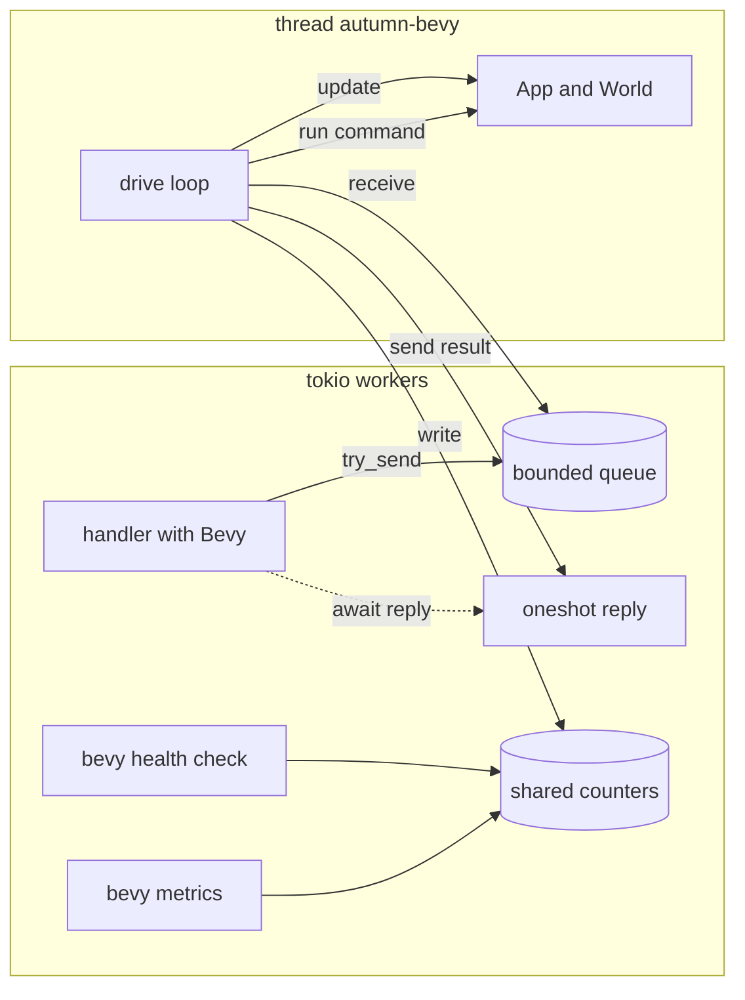
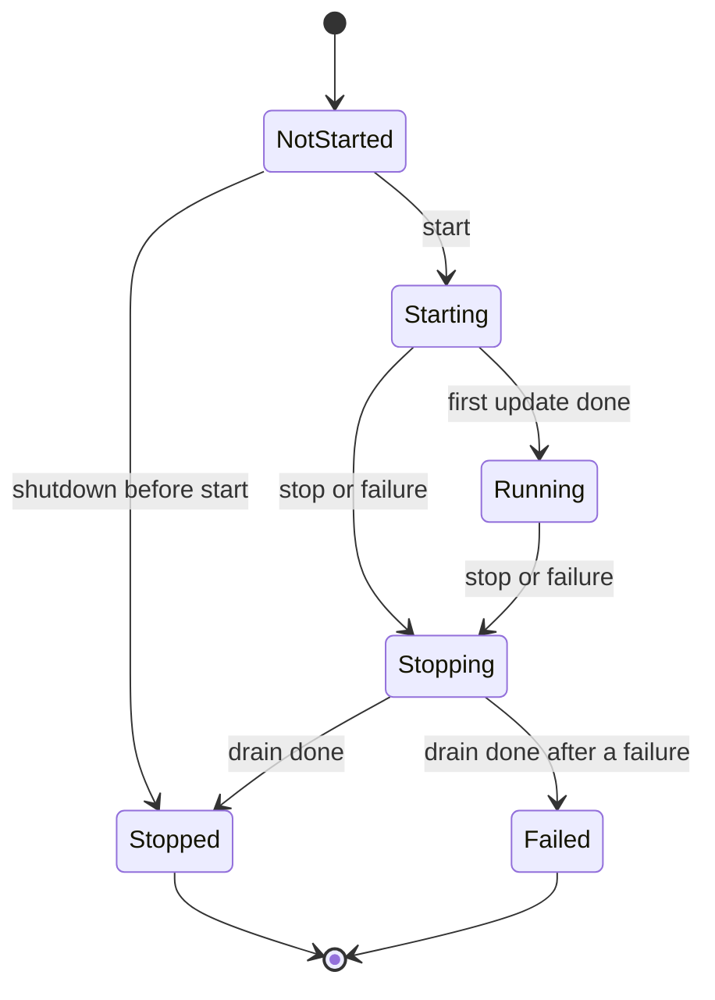

# autumn-plugin-bevy

Run a headless [Bevy](https://bevyengine.org) ECS app inside an
[Autumn](https://github.com/autumn-foundation/autumn) web server.

The plugin gives Autumn handlers safe async access to one Bevy `World`.
Use it for a game server, a simulation, or any state that a fixed-rate loop
changes.

- One Bevy app runs on its own thread, `autumn-bevy`.
- Handlers send commands to the world through a bounded queue.
- The plugin starts the thread before the server accepts requests, and
  stops it during shutdown.
- The plugin adds the `bevy` health check and the `bevy_*` metrics.
- A panic in a command does not stop the world. A panic in an update
  stops the world, and the server continues.

The plugin mounts no routes.

## Install

```toml
[dependencies]
autumn-web = "0.9"
autumn-plugin-bevy = "0.1"
# Add these two directly: the Bevy derive macros look for them by name.
bevy_app = "0.20"
bevy_ecs = "0.20"
```

The crate uses `bevy_app` and `bevy_ecs` only. It does not use the `bevy`
crate, because that crate adds rendering.

## Quick start

```rust,no_run
use autumn_plugin_bevy::prelude::*;
use autumn_web::AutumnResult;
use autumn_web::prelude::*;
use bevy_app::{App, Update};
use bevy_ecs::prelude::*;

#[derive(Resource, Default)]
struct Counter(u64);

fn count(mut counter: ResMut<Counter>) {
    counter.0 += 1;
}

#[get("/counter")]
async fn counter(bevy: Bevy) -> AutumnResult<String> {
    let value = bevy.with_world(|world| world.resource::<Counter>().0).await?;
    Ok(value.to_string())
}

#[autumn_web::main]
async fn main() {
    autumn_web::app()
        .plugin(BevyPlugin::new(|app: &mut App| {
            app.init_resource::<Counter>().add_systems(Update, count);
        }))
        .routes(routes![counter])
        .run()
        .await;
}
```

`examples/counter.rs` is a full app. Run it with
`cargo run --example counter`.

## How it works



- The Bevy `App` is not `Send`. So one thread makes it, drives it, and
  drops it.
- A command is a closure `FnOnce(&mut World) -> R`. The thread runs it
  between two updates. Thus a command never sees half of a frame.
- A call puts its command into the queue and does not block. When the
  queue is full, the call fails at once with `Busy`.
- In each pass, the loop first reads the stop flag. Then it runs a due
  update. Then it runs one command. So a flood of commands cannot stop the
  updates.
- The health check and the metrics read counters only. They never wait
  for the Bevy thread.

## Lifecycle



1. The startup hook starts the thread. The thread runs your setup steps, the
   Bevy plugin steps, and the first update. The first update runs
   `Startup`.
2. The hook waits until the first update is done. If setup panics or takes
   too long, the server does not start.
3. The shutdown hook sets the stop flag. The thread runs one last update with
   `AppExit::Success`, so your systems can save state.
4. The thread rejects the queued commands. Then it drops the world on its own
   thread.

The status goes in one direction only. `Stopped` and `Failed` are the end.
There is no restart.

The thread also stops in these cases:

- A system writes `AppExit::Success`. The status becomes `Stopped`.
- A system writes `AppExit::Error`, or an update panics. The status becomes
  `Failed`.
- The runtime and all its handles are dropped.

The Autumn server continues in all cases. Calls then fail with 503.

## Call the world

Use the `Bevy` extractor in a handler:

```rust,no_run
use autumn_plugin_bevy::Bevy;
use autumn_web::AutumnResult;

async fn spawn(bevy: Bevy) -> AutumnResult<String> {
    let entity = bevy.with_world(|world| world.spawn_empty().id()).await?;
    Ok(format!("{entity:?}"))
}
```

| Method | What it does |
| --- | --- |
| `with_world(f)` | Runs `f` on the world and returns its result. |
| `with_world_timeout(limit, f)` | The same, with its own wait limit. `None` waits with no limit. |
| `step(n)` | Runs `n` updates. Only for `TickMode::Manual`. |
| `status()`, `ticks()` | Read the status and the update count. They do not wait. |

Rules for a command:

- Keep it short. The next update waits for it.
- It is sync. Do async work before or after the call.
- Do not call the same runtime from inside a command. That call fails with
  `Reentrant`, because it would wait for itself.
- When the wait limit passes before the command starts, the command does not
  run. Thus a timed-out request makes no hidden change.

The methods of `Bevy` return `AutumnResult` with a safe HTTP error. Use
`bevy.handle()` to get a `BevyHandle`. Its methods return the typed
`RuntimeError`.

Do not use `?` on a `RuntimeError` in a handler. The `From` impl of
autumn-web makes every error a 500. Use `RuntimeError::into_autumn_error`.

| `RuntimeError` | HTTP | Body text |
| --- | --- | --- |
| `Busy` | 503 | "bevy runtime is busy" |
| `NotRunning`, `Timeout`, `SetupPanicked`, `StartupTimeout`, `ShutdownTimeout` | 503 | "bevy runtime is unavailable" |
| `NotInstalled`, `CommandPanicked`, `Reentrant`, `WrongMode`, `AlreadyStarted`, `Spawn` | 500 | "internal error" |

Autumn also hides the detail of each 5xx response. A panic message goes to
the log only.

Outside a handler, use `BevyHandle::from_state(&state)`. A test, a job, or a
command-line tool can use `BevyRuntime` with no Autumn app.

## Configuration

The defaults are safe for a server. Change them in code:

```rust,no_run
use std::time::Duration;

use autumn_plugin_bevy::{BevyConfig, BevyPlugin, QueueCapacity, TickMode, TickRate};

# fn main() -> Result<(), autumn_plugin_bevy::ConfigError> {
let config = BevyConfig::default()
    .with_tick_mode(TickMode::Fixed(TickRate::new(30)?))
    .with_queue_capacity(QueueCapacity::new(256)?)
    .with_command_timeout(Some(Duration::from_secs(2)));
let plugin = BevyPlugin::new(|_app| {}).config(config);
# let _ = plugin;
# Ok(())
# }
```

Or read the `[bevy]` table of `autumn.toml`:

```toml
[bevy]
tick_mode = "fixed"      # "fixed" or "manual"
tick_hz = 30
queue_capacity = 256
command_timeout_ms = 2000
```

```rust,no_run
use autumn_plugin_bevy::{BevyConfig, BevyPlugin};

# fn main() -> Result<(), autumn_plugin_bevy::ConfigError> {
let config = BevyConfig::load("autumn.toml")?;
let plugin = BevyPlugin::new(|_app| {}).config(config);
# let _ = plugin;
# Ok(())
# }
```

| Key | Default | Range |
| --- | --- | --- |
| `tick_mode` | `"fixed"` | `"fixed"`, `"manual"` |
| `tick_hz` | 60 | 1 to 1000 |
| `queue_capacity` | 1024 | 1 to 65536 |
| `command_timeout_ms` | 5000 | 1 or more |
| `startup_timeout_ms` | 10000 | 1 or more |
| `stall_threshold_ms` | 1000 | 1 or more |
| `shutdown_timeout_ms` | 5000 | 1 or more |
| `manual_time_step_ms` | 16 (1/60 s in code) | 1 or more |

- An unknown key is an error. The error names the key.
- The plugin declares `[bevy]`, so `server.strict_config = true` accepts it.
- The plugin does not read the file itself. Call `BevyConfig::load`. Profile
  files and `AUTUMN_*` variables do not apply to this table.
- A setter after `load` changes the loaded value.

### Tick modes

- `TickMode::Fixed(rate)`: updates run at a fixed rate. When an update is
  late, the loop skips the missed ticks and runs no burst.
  `bevy_tick_overruns_total` counts the skipped ticks.
- `TickMode::Manual`: updates run only for `step(n)`. Use it for tests and
  turn-based apps. A command sent before `step` sees the state before the
  step.

### Time

The `time` feature is on by default. If setup does not add
`bevy_time::TimePlugin`, the plugin adds it. In `TickMode::Manual`, `Time`
then goes forward by `manual_time_step` on each update. Thus a test gets the
same result each time it runs.

If setup adds `TimePlugin`, the plugin does not change it.

## Health and metrics

The plugin registers the health indicator `bevy` in the `Readiness` group.
It is up only when both conditions are true:

- The status is `Running`.
- The thread is not busy with one update or one command for longer than
  `stall_threshold`.

When it is down, the detail `reason` is `not_started`, `starting`,
`stalled`, `stopping`, `stopped` or `failed`. The other details are
`status`, `ticks`, `queue_depth` and `busy_ms`.

The plugin registers the metrics source `bevy`:

| Family | Kind | Labels |
| --- | --- | --- |
| `bevy_up` | gauge, 0 or 1 | none |
| `bevy_ticks_total` | counter | none |
| `bevy_tick_overruns_total` | counter | none |
| `bevy_last_tick_seconds` | gauge | none |
| `bevy_queue_depth` | gauge | none |
| `bevy_entities` | gauge, with the Bevy internal entities | none |
| `bevy_commands_total` | counter | `outcome`: `ok`, `panicked`, `busy`, `cancelled`, `timeout`, `rejected` |

The label values are fixed, so the metrics cannot grow without limit.

## Tests

`TestApp` runs the startup hook of the plugin. So the world is ready when
`build()` returns:

```rust,no_run
use autumn_plugin_bevy::{BevyConfig, BevyHandle, BevyPlugin};
use autumn_web::test::TestApp;

# async fn run() {
let client = TestApp::new()
    .plugin(BevyPlugin::new(|_app| {}).config(BevyConfig::manual()))
    .build();
let bevy = BevyHandle::from_state(client.state()).expect("the plugin adds a handle");
let ticks = bevy.step(3).await.expect("three updates");
assert_eq!(ticks, 4); // The first update, then three steps.
# }
```

Use `BevyConfig::manual()` and `step(n)` for tests that must give the same
result each time. For tests with a paused tokio clock, set
`with_command_timeout(None)`. The Bevy thread is a real thread and does not
follow the paused clock.

## Limits and safety

- One Bevy world for each Autumn app. Autumn skips a second `BevyPlugin`.
- The plugin does not add `TaskPoolPlugin`, `LogPlugin`,
  `TerminalCtrlCHandlerPlugin` or `PanicHandlerPlugin`. Each one has an
  effect on the whole process, so your app decides.
- The plugin does not set the runner or the error handler of the Bevy app.
- Do not show a raw `Entity` value as a public ID. Map it to your own ID.
- Add a rate limit to public routes that call the world.
- With `panic = "abort"`, a panic stops the process. The plugin logs a
  warning at start.
- Register `BevyPlugin` after the Autumn plugins that its systems use.

## Verification

`verification/bevy_runtime.rs` is a [Verus](https://github.com/verus-lang/verus)
model of the lifecycle, the queue and the tick schedule. It proves these
rules:

- A terminal status does not change.
- Each status change makes the rank go up.
- The queue never holds more than its capacity.
- At the end, each accepted command has its reply.
- After a failure, no update and no command runs.
- The health check is up only in `Running`.
- The next tick deadline is in the future, and late ticks are skipped.

The test `lifecycle_matches_spec_table` checks that the Rust state machine is
the same as the model. The CI job `Verus proofs` runs Verus on each change to
the model.

## Compatibility

| This crate | autumn-web | Bevy | Rust |
| --- | --- | --- | --- |
| 0.1 | 0.9 | 0.20 | 1.95 or later |

## License

Apache-2.0. See `LICENSE`.
