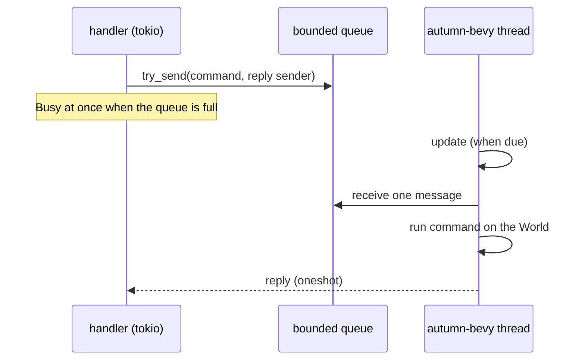

# ADR 0001: One Bevy thread and a bounded command queue

- Status: Accepted
- Date: 2026-11-02
- Tags: threading, api-design

## Context

Autumn handlers are async tasks on tokio worker threads. A Bevy app is a
sync loop: `App::update` runs the schedules once.

- `bevy_app::App` is not `Send`. Its runner is a
  `Box<dyn FnOnce(App) -> AppExit>`. So the app cannot move to another
  thread after we make it.
- `App::update` can take many milliseconds. A tokio worker must not wait
  that long.
- Many handlers can want the world at the same time. The world has one
  owner.

## Decision

One OS thread, `autumn-bevy`, makes the app, drives it and drops it. The
async side sends messages to that thread through a bounded
`std::sync::mpsc::sync_channel`.

1. A command is a closure `FnOnce(&mut World) -> R + Send`. The thread runs
   it between two updates. So a command never sees half of a frame.
2. A call uses `try_send`. It never blocks a worker. A full queue gives
   `Busy`.
3. The reply comes back on a `tokio::sync::oneshot` channel.
4. In each pass, the loop reads the stop flag first. Then it runs a due
   update. Then it runs one message. So commands cannot stop the updates.
5. A command whose caller has gone does not run.
6. The fixed-rate schedule skips late ticks. The next deadline is
   `prev + period` when on time, and `now + period` when late. There is no
   burst.
7. The health check and the metrics read atomics in a shared struct. They
   never send a message.

## Alternatives

- **A mutex around the world.** Rejected. The `App` is not `Send`, and a
  lock held across an update blocks tokio workers.
- **`spawn_blocking` for each update.** Rejected. The app cannot move
  between threads.
- **Snapshots through `tokio::sync::watch`.** Deferred. It is good for read
  traffic, but it needs a copy of the state. `with_world` covers reads and
  writes. A later version can add snapshots.
- **An unbounded channel.** Rejected. A slow world would let memory grow with
  no limit.

## Consequences

- A long command delays the next update. The docs say to keep commands
  short. The health check reports `stalled`.
- A call from the Bevy thread into the same runtime would wait for itself.
  A thread-local `RuntimeId` detects this, and the call fails with
  `Reentrant`.
- The state machine and the schedule are pure functions. The Verus model in
  `verification/bevy_runtime.rs` proves their rules, and table tests check
  the Rust code against the model.
