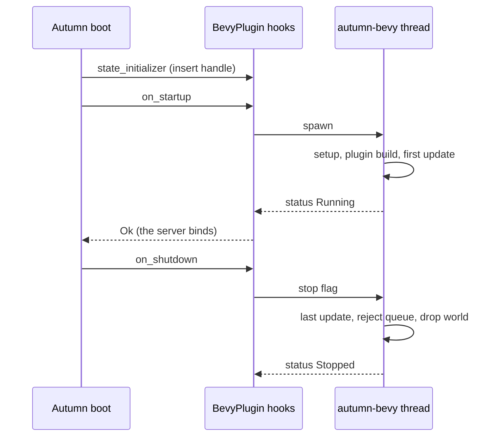

# ADR 0003: Start the thread in the startup hook

- Status: Accepted
- Date: 2026-11-02
- Tags: lifecycle, autumn-integration

## Context

Autumn gives a plugin three places to run code at boot:

- `state_initializer`: sync. It runs in each mode that builds an
  `AppState`: serve, static build, retention, data capsule, one-off task and
  replay.
- `on_startup`: async. It runs in serve and one-off task modes. An `Err`
  stops the boot.
- `on_shutdown`: async, with no `AppState`. It runs during the graceful
  drain, under a time limit.

`TestApp` runs plugin startup hooks. It calls each hook on a helper thread
through `Handle::block_on`. On a `current_thread` test runtime, that call
cannot drive tokio timers. `TestApp` does not run shutdown hooks.

## Decision

1. `Plugin::build` makes the runtime, status `NotStarted`. It holds the
   runtime in an `Arc`.
2. A `state_initializer` puts a `BevyHandle` into the app state. It does not
   start the thread, because static builds and replays must not run a
   simulation.
3. `on_startup` calls `start` and then `wait_ready`. `wait_ready` waits on a
   `Condvar` inside `spawn_blocking`, with no tokio timer. So it also works
   under `TestApp` on a `current_thread` runtime.
4. Ready means: setup, the plugin build steps and the first update are done.
   The first update runs `Startup`. So the first request sees what `Startup`
   made.
5. `on_shutdown` sets the stop flag and waits, with a limit, for a terminal
   status.
6. When the runtime and all handles drop, the channel closes and the thread
   stops. This is the stop path under `TestApp`.

## Consequences

- A setup panic or a slow setup stops the boot with a clear error.
- `on_startup` also runs in one-off task mode, so `autumn task` starts the
  world too.
- A runtime used with no Autumn app has the same API: `start`,
  `wait_ready`, `shutdown`.
